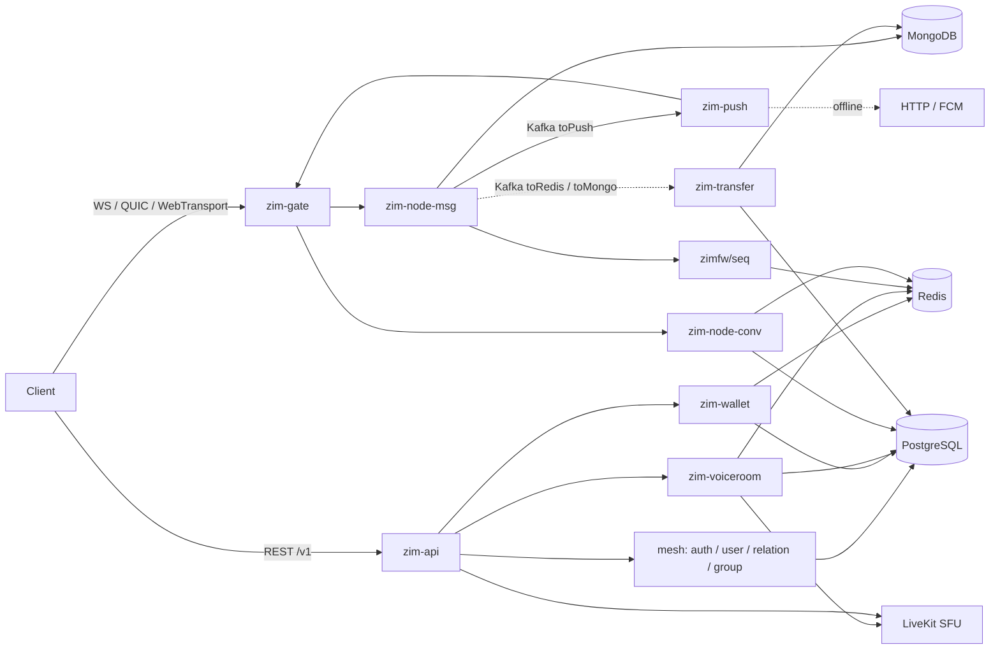

# ZIM

<p align="center">
  <strong>A single-tenant, self-hosted instant messaging server</strong><br/>
  <sub>Go · WebSocket/protobuf · gRPC mesh · PostgreSQL · MongoDB · Redis · Kafka</sub>
</p>

<p align="center">
  <a href="https://github.com/zciyuan/zim/actions/workflows/ci.yml"></a>
  
  
  
  
</p>

**ZIM** is a single-tenant, self-hosted instant messaging server written in Go. Thirteen services cover auth, messaging, conversations, sync, push, RTC signaling, voice rooms, a USDT wallet (deposits/withdrawals, red packets, tips), webhooks and admin APIs. Clients connect over WebSocket + protobuf; services talk to each other over a gRPC mesh; message writes flow through a Kafka pipeline that assigns seq, deduplicates and persists to multiple stores.

> **Status: alpha.** Protocols, schemas and configuration are still converging; production use is not recommended yet. Issues and PRs welcome.

## Why ZIM

- **Single tenant, single app**: clean deployment boundaries for private clouds, industry IM and enterprise messaging — no multi-tenant complexity.
- **No message loss, fully traceable**: per-conversation seq, send idempotency, Kafka pipeline with DLQ, Redis result queue, MongoDB aggregate documents.
- **Security built in**: burn-after-reading with physical TTL erasure, group mute (whole-group / scheduled / per-category), anti-spam and sensitive-word auto-mute, anti-screenshot watermark and a DLP audit/penalty loop.
- **One protocol, every client**: WebSocket + protobuf; optional QUIC/WebTransport (experimental); REST for accounts, friends, groups, conversations, sync, uploads and the wallet.
- **Complete social model**: friend requests/blocklists/remarks/stars, groups and family groups with member permissions, mute, disband and leave.
- **Real-time**: online push, presence/typing, RTC signaling with the LiveKit SFU, group/family voice rooms, and voice-room seat gameplay (take/leave seat, force mute, lock seat, hand-up, invite).
- **Money loop**: double-entry USDT ledger (int64 micro-USDT), deposit/withdrawal risk controls, a daily reconcile identity, red packets (luck/dedicated, Lua claim, expiry refund) and three-leg gift tips with platform fees.
- **Operable**: Prometheus metrics, `/healthz` + `/readyz`, structured logging, Redis-lock elected maintenance, degradation switches.
- **Admin ready**: `/admin` REST for users, groups, family groups, messages, audits, sensitive words, config, push certificates, reports and stats; the admin UI lives in the separate [zim-admin](https://github.com/zciyuan/zim-admin) repo.

## Features

| Domain | Capabilities |
|---|---|
| Auth | Register, username/password login, access/refresh tokens, WS ticket, multi-device login, ban/kick-offline |
| User | Profile get/update, search, device registry, online status subscription |
| Relations | Friend request/accept/reject/delete, remarks, stars, blocklist |
| Groups | Create/disband, member add/remove, admins, mute, group profile, search visibility |
| Family groups | Create/disband, members, family voice rooms |
| Messages | Single/group chat, per-conversation seq, idempotency, seq-based pull, recall, edit, delete, search, quote/merge, reactions |
| Burn after reading | `burn_ttl` sends, countdown starts on read ack (`1518`), `1910/1911` burn pushes, Mongo TTL physical erasure, offline-push masking |
| Group security | Group security settings (`1318`) / member restrictions (`1319`): scheduled/category/whole-group mute, new-member protection, anti-screenshot watermark, screenshot DLP reports (`1519`) with audit + auto penalties, anti-spam and sensitive-word auto-mute |
| Conversations | List, pin, delete, read/unread, receive options, unread counts |
| Sync | Login SyncState, `SyncCheck` diff window, `SyncMissing` gap repair |
| Real-time | Presence, typing, RTC signaling (LiveKit SFU), group/family voice rooms |
| Voice rooms | Create/list/join (`1808-1810`), seat state machine (`1812-1819`: take/leave/kick/force-mute/lock seat, hand-up, invite), `1912-1914` pushes, LiveKit publish-permission enforcement, 30s reconnect grace, 300s empty-room GC |
| Wallet | Double-entry USDT ledger (8 tables), deposits/withdrawals (TRC20/ERC20/BEP20 callbacks), pay password + TOTP, risk controls (24h freeze window, internal-address blocking), daily reconcile identity; `/v1/wallet/*` REST |
| Red packets & tips | Luck packets (integer double-mean split) and dedicated packets, Redis Lua claims, async credit with per-minute compensation, 24h expiry refunds, three-leg gift tips with platform fees |
| Push | Online Multicast; offline dummy / HTTP / FCM; per-device routing and rate limiting |
| Files | Local upload; S3-compatible object storage (SeaweedFS / MinIO / Ceph RGW / OSS) |
| Webhooks | Message/group event callbacks with HMAC-SHA256 signature, 3 retries, DLQ replay |
| Admin | Users/groups/family groups/messages/audits/sensitive words/config/push certificates/reports/stats via `/admin` |
| Observability | Prometheus metrics, health checks, structured logs, trace fields |

## Tech stack

| Layer | Choice |
|---|---|
| Language / framework | Go 1.27, [due](https://github.com/dobyte/due) v2.6.8 |
| Client access | WebSocket + protobuf; QUIC / WebTransport (experimental) |
| Service-to-service | gRPC mesh (due transport) |
| Metadata / messages | PostgreSQL 16, MongoDB 7 |
| Cache / routing | Redis 7 (locate, seq, idempotency, readseq) |
| Async pipeline | Kafka (`toRedis`, `toMongo`, `toPush`, `toOfflinePush` + event topics `burnMediaDelete`, `groupMemberStatus`, `dlpScreenshotAudit`, `walletRpClaim`, `walletRpRefund`, `walletTipSettled`) |
| Registry / config | Nacos 2.5 |
| Audio/video | LiveKit SFU |
| Object storage | S3-compatible (SeaweedFS / MinIO / Ceph RGW / OSS) |

## Architecture



Message write path (same for single and group chat):

1. Client sends `op:1501/1502` → gate forwards to `zim-node-msg`;
2. node-msg validates and publishes to `toRedis`;
3. `zim-transfer` assigns seq, deduplicates, persists to MongoDB, updates conversations and publishes to `toPush`;
4. `zim-push` locates online gates in batches and multicasts per GID; offline devices go through the offline provider;
5. transfer writes the result back to Redis and node-msg replies to the client.

| Service | Responsibility |
|---|---|
| `zim-gate` | WebSocket/QUIC/WebTransport access, handshake auth, connection routing |
| `zim-node-msg` | Message validation, seq/idempotency orchestration, online push; burn/group-security/DLP protocol handling |
| `zim-node-conv` | Conversation list, pin/delete, read/unread, receive options |
| `zim-mesh-auth/user/relation/group` | Auth, profiles, friends, groups/family groups |
| `zim-transfer` | Kafka consumption, Mongo persistence, conversation updates, `toPush` |
| `zim-push` | Online multicast, offline provider routing, rate limiting |
| `zim-wallet` | USDT double-entry ledger, deposit/withdrawal risk controls, red packets/tips, reconcile and compensation tasks |
| `zim-voiceroom` | Voice-room seat state machine (Redis Lua), LiveKit permission enforcement, webhook calibration |
| `zim-api` | `/v1`, `/api`, `/admin` REST |
| `zim-crontask` | Expired-data cleanup, dead-gate locate reaping, burn sweep and media physical deletion |
| `zimfw` | Framework layer: contract/route/seq/idem/pipe/multi/rtc/testkit |

## Quick start

### Docker Compose

Prerequisites: Docker 24+, Compose v2, 8 GB+ RAM (16 GB recommended; 13 services + PG/Mongo/Redis/Kafka/Nacos/LiveKit/SeaweedFS).

```bash
git clone https://github.com/zciyuan/zim.git
cd ZIM
docker compose -f deploy/compose/docker-compose.dev.yml up -d --build
```

After startup:

| Endpoint | Address |
|---|---|
| REST | `http://127.0.0.1:8080` |
| WebSocket | `ws://127.0.0.1:3553/ws?token=...&platform=2&sdk=web` |
| Nacos | `http://127.0.0.1:8848/nacos` (group `ZIM`) |
| PostgreSQL | `127.0.0.1:15432` |
| Redis | `127.0.0.1:16379` |
| MongoDB | `127.0.0.1:27017` |
| Kafka | `127.0.0.1:9092` |

Dev accounts: `alice` / `password`, `bob` / `password` (see [dev_seed.sql](<deploy/sql/dev_seed.sql>), local only).

```bash
docker compose -f deploy/compose/docker-compose.dev.yml ps
docker compose -f deploy/compose/docker-compose.dev.yml logs -f zim-gate zim-node-msg
docker compose -f deploy/compose/docker-compose.dev.yml down
```

> The default configuration ships dev-only secrets and a `dev-admin-token`; use them locally only. Replace them before deploying to shared/production environments; `/admin` must sit behind an intranet/VPN with a dedicated service token + mTLS.

### Build from source

Go 1.27+:

```bash
go install github.com/magefile/mage@v1.17.2

mage build          # 13 binaries → build/bin/
mage buildService zim-gate
mage test           # root module + zimfw, -race
mage lint
mage cover          # coverage report → _output/coverage.html
mage configCheck    # validate etc-default.toml of 13 services
```

With dependencies ready, run a single service directly:

```bash
./build/bin/zim-api -etc ./configs/zim-api
```

Configuration is read by due via `-etc` (override with `DUE_ETC`); business keys are `etc.zim.*`, transport/registry/locate keys follow due conventions.

### Minimal verification

```bash
curl -s -X POST http://127.0.0.1:8080/v1/auth/token \
  -H 'Content-Type: application/json' \
  -d '{"username":"alice","password":"password","platform":2}'
```

Take `data.access_token` and connect:

```text
ws://127.0.0.1:3553/ws?token=<access_token>&platform=2&sdk=web
```

Every service exposes `/healthz`, `/readyz`, `/metrics` and `/version` on `etc.zim.health.addr` (`zim-api` defaults to `:8081`).

## Protocol

WebSocket frame:

```text
+--------+-----+--------+--------+---------------------------+
| len(4) | ver | op(2)  | seq(4) | Envelope (protobuf)       |
+--------+-----+--------+--------+---------------------------+
```

- `len`: big-endian byte count; `ver`: currently `1`; `op`: opcode; `seq`: request sequence.
- `Envelope` carries `XxxReq` / `XxxRes` message pairs.

Opcode segments:

| Segment | Domain | Segment | Domain |
|---|---|---|---|
| 1000 | Auth | 1500 | Messages |
| 1100 | User | 1600 | Sync |
| 1200 | Relations | 1700 | Chat rooms (reserved) |
| 1300 | Groups / family groups | 1800 | RTC (calls + voice rooms) |
| 1400 | Conversations | 1900 | Pushes |
| 9000 | Infrastructure / rate control | | |

REST prefixes: `/v1` clients, `/api` server-side integrations, `/admin` admin console (called only by [zim-admin](https://github.com/zciyuan/zim-admin)). Error codes are six-digit segments (`100xxx` auth … `900xxx` infrastructure); feature-1.1 extensions follow ADR-0043 (burn `1501xx`, group security `1301xx`, voice room `1801xx`, wallet `200xxx`).

## Layout

```text
cmd/zim-<service>/{main.go,app/}      # service entry points; stateful services add app/{app.go,logic,api,middleware}
configs/zim-<service>/                # etc.toml + etc-default.toml
zimfw/                                # standalone framework submodule (contract/route/seq/idem/pipe/multi/rtc/testkit)
internal/
  component/                          # postgres/mongo/redis/health/metrics/token singletons
  define/                             # app constants and Kafka topics
  protocol/<domain>/                  # client wire protocol (XxxReq/XxxRes)
  service/<domain>/{server,client,pb} # internal mesh RPC (XxxArgs/XxxReply)
  service/<domain>/                   # in-process domain services
  dao/ model/ utils/ version/
deploy/                               # Dockerfile / compose / Helm / SQL / LiveKit
```

## Related repositories

| Repository | Description |
|---|---|
| [zim](https://github.com/zciyuan/zim) | Server (this repo): 13 services + the `zimfw` framework layer |
| [zim-admin](https://github.com/zciyuan/zim-admin) | Admin console: `/admin` UI based on [GoWind Admin](https://gitee.com/tx7do/go-wind-admin), built and released independently |
| [zim-web-client](https://github.com/zciyuan/zim-web-client) | Product frontend: React + TypeScript, one codebase for Web / PC / App (ADR-0029) |

The three repos have independent dependencies, builds and releases. The server repo hosts no frontend code: the admin console only calls `/admin`; clients only use `/v1` + WebSocket. Local sibling-directory convention: `ZIM/` (remote `zim`), `zim-admin/`, `zim-web/` (remote `zim-web-client`).

## Deployment

Production deployment specs live in the [Helm chart](<deploy/helm/README.md>). The full architecture, protocol and acceptance docs (ZIM-01/02/03, ADRs) are maintained separately from this repo.

For docker-compose remote/temporary servers, use the provided scripts and follow the disk-maintenance rules (ZIM-03 §2.14): `deploy/scripts/redeploy.sh` (rebuild only with `--build`, which purges BuildKit cache afterwards) plus the daily cron (`deploy/scripts/cron-daily.sh`, nacos log rotation etc.).

## Testing & quality

```bash
mage test      # root module + zimfw, -race
mage lint      # golangci-lint (root module + zimfw)
mage cover     # coverage report
```

CI ([ci.yml](<.github/workflows/ci.yml>)) runs `go test`, `golangci-lint`, `mage configCheck` and builds all 13 binaries. `zimfw/testkit` provides 6 due contract tests (BindKick / MultiDevice / LocateRedirect / PushAck / ChannelPublish / GracefulDrain).

Feature smoke tools (after the compose stack is up):

```bash
go run ./tools/featprobe   # 12 dual-device WS assertions: burn / group security / voice room
go run ./tools/walletsmoke # full money loop: deposit → red packet → tip → reconcile identity = 0
go run ./tools/rpprobe     # red-packet card message (msg_type=7, ext_type=1) end-to-end
go run ./tools/seede2e     # seed an alice↔bob conversation for browser e2e suites
go run ./tools/hashpwd     # verify/generate bcrypt password hashes (dev_seed helper)
```

Load tools:

```bash
go run ./tools/load -connections 10000 -hold 30s -dial-concurrency 100
go run ./tools/msgload -messages 100
```

> Unit-test coverage is still being filled in and there are no Go benchmarks yet; capacity figures must be measured in the target environment — this README makes no QPS/connection promises.

## Project status

- **Alpha**: the core loop (login, single/group chat, conversations, sync phase 1, online push, RTC signaling, admin APIs) works; feature set 1.1 (burn after reading, group security, voice rooms, USDT wallet, red packets/tips) is implemented and verified by local and remote smoke tests (ADR-0043). Protocols and schemas may still change.
- TODO: sync phase 2 (`1606/1906`), 90-day warm tier, real push receipts, compliance (real-name/account deletion/minors/180-day retention), admin UI, multi-region, TURN, benchmarks, and the effect/risk-control consumers for red-packet/tip/audit events.
- Known limitations: LiveKit single region; offline push requires vendor credentials; `/admin` must stay on an intranet; wallet chain interactions use a dummy signer (a real KMS/chain adapter is required to go live); docs are primarily in Chinese.

## Contributing

Issues and PRs welcome. For large changes, open an issue first to align on design.

- Commit messages: `<type>(<scope>): <subject>`, in English, type ∈ `feat/fix/refactor/test/docs/chore`.
- Before a PR, run at least: `mage test`, `mage lint`, `mage configCheck`.
- New code coverage ≥ 60%, critical paths (seq/idempotency/encoding) ≥ 80%; interface fields and error codes must match `ZIM-02` verbatim.
- Style: stdlib `encoding/json` / `errors` are banned (depguard); hand-written structs go in `types.go`; Redis Lua goes in `lua.go`.
- DCO required (`git commit -s`); no CLA for now.

## Security

- Never commit real keys, certificates, public IPs or production configs; the `dev-only-*` values in the repo are local only.
- Report vulnerabilities privately via GitHub Security Advisory, not a public issue.
- `/admin` is intranet/VPN only, uses a dedicated service token + mTLS, rotated regularly; never bake the service token into a frontend bundle.

## License

Apache-2.0, see [LICENSE](LICENSE). Third-party dependencies, external services and their licenses: [THIRD_PARTY_NOTICES.md](THIRD_PARTY_NOTICES.md).

## Acknowledgements

- [due](https://github.com/dobyte/due) — Go distributed framework
- [LiveKit](https://github.com/livekit) — SFU / RTC
- [GoWind Admin](https://gitee.com/tx7do/go-wind-admin) / [Vben Admin](https://github.com/vbenjs/vue-vben-admin) — admin console and frontend scaffolding
- PostgreSQL, MongoDB, Redis, Kafka, Nacos, SeaweedFS / MinIO and other infrastructure projects
