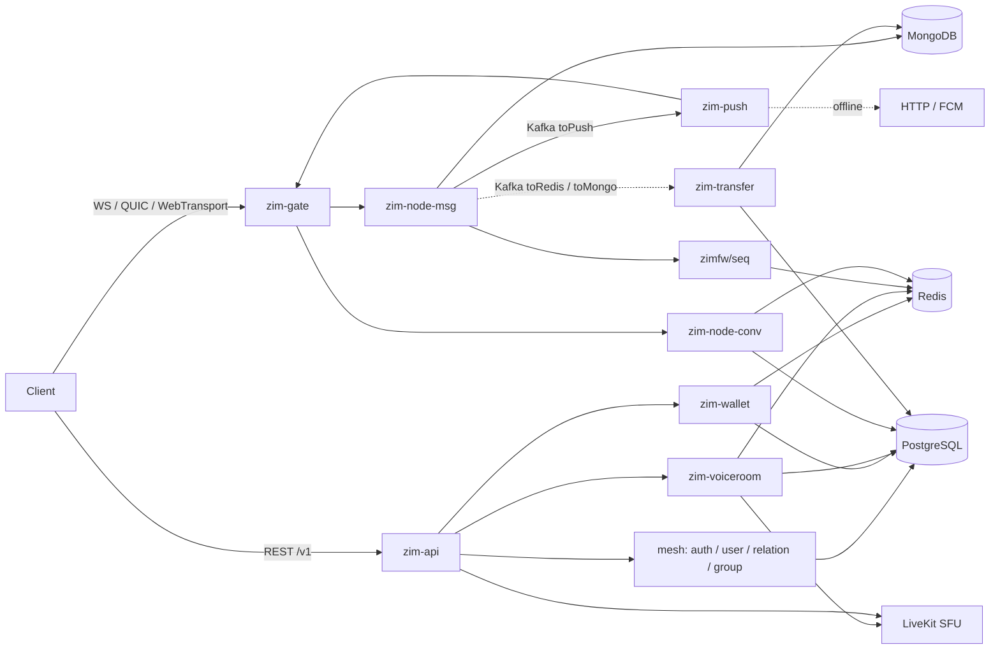

# ZIM

<p align="center">
  <strong>单租户、可自托管的即时通讯服务端</strong><br/>
  <sub>Go · WebSocket/protobuf · gRPC mesh · PostgreSQL · MongoDB · Redis · Kafka</sub>
</p>

<p align="center">
  <a href="https://github.com/zciyuan/zim/actions/workflows/ci.yml"></a>
  
  
  
  
</p>

**ZIM** is a single-tenant, self-hosted instant messaging server written in Go. Thirteen services cover auth, messaging, conversations, sync, push, RTC signaling, voice rooms, a USDT wallet, webhooks and admin APIs; clients speak WebSocket + protobuf, services speak gRPC mesh.

ZIM 是面向私有化部署的 IM 服务端基线：**单租户、单 App**，一套服务覆盖认证、单聊/群聊、会话、同步、在线/离线推送、RTC 信令、语音房、USDT 钱包（充提/红包/打赏）、Webhook 与管理端 API。客户端通过 WebSocket + protobuf 接入；服务之间走 gRPC mesh；消息写入经 Kafka 管道完成 seq、幂等与多存储落盘。

> **Status: alpha.** 协议、表结构和配置仍在收敛，暂不建议直接用于生产；欢迎 issue / PR。

## 为什么是 ZIM

- **单租户、单 App**：部署边界清晰，适合私有云、行业 IM、企业内部通信，不引入多租户复杂度。
- **消息不丢、可追溯**：会话内 seq、发送幂等、Kafka 管道 + DLQ、Redis result、Mongo 聚合文档。
- **安全治理内置**：阅后即焚（TTL 物理擦除）、群禁言/定时禁言/分类禁言/防刷屏与敏感词自动禁言、防截屏水印与 DLP 审计惩罚闭环。
- **一套协议覆盖多端**：WebSocket + protobuf；可选 QUIC/WebTransport（实验）；REST 覆盖账号、好友、群、会话、同步、上传、钱包。
- **完整社交模型**：好友申请/黑名单/备注/星标，群与家庭组、成员权限、禁言、解散/退出。
- **实时能力**：在线推送、presence/typing、RTC 信令 + LiveKit SFU、群/家庭语音房间、语音房麦位玩法（上麦/闭麦/锁麦/举手/邀请）。
- **资金闭环**：USDT 复式账本（int64 微 USDT）、充提风控、日终对账恒等式、红包（拼手气/专属、Lua 抢包、过期退款）与礼物打赏三段账。
- **可运维**：Prometheus metrics、`/healthz` + `/readyz`、固定日志字段、Redis 锁选主清理、降级开关。
- **管理端就绪**：`/admin` REST 覆盖用户、群、家庭组、消息、审计、敏感词、配置、推送证书、举报与统计；管理 UI 在独立仓 [zim-admin](https://github.com/zciyuan/zim-admin)。

## 功能

| 域 | 能力 |
|---|---|
| 认证 | 注册、用户名密码登录、access/refresh token、WS ticket、多端登录、封禁/踢下线 |
| 用户 | 资料查询/更新、搜索、设备登记、在线状态订阅 |
| 关系 | 好友申请/同意/拒绝/删除、备注、星标、黑名单 |
| 群组 | 创建/解散、成员增删、管理员、禁言、群资料、搜索可见性 |
| 家庭组 | 创建/解散、成员、家庭语音房间 |
| 消息 | 单聊/群聊、会话内 seq、幂等、按 seq 拉取、撤回、编辑、删除、搜索、引用/合并、reaction |
| 阅后即焚 | `burn_ttl` 发送、已读启动倒计时（`1518`）、`1910/1911` 焚毁推送、Mongo TTL 物理擦除、离线推送脱敏 |
| 群安全 | 群安全设置（`1318`）/成员禁言（`1319`）：定时/分类/全员禁言、新人保护、防截屏水印、截屏上报 DLP（`1519`）审计 + 自动惩罚、防刷屏/敏感词自动禁言 |
| 会话 | 列表、置顶、删除、已读/未读、接收选项、未读数 |
| 同步 | 登录 SyncState、`SyncCheck` 差异窗口、`SyncMissing` 缺口补齐 |
| 实时 | presence、typing、RTC 信令（LiveKit SFU）、群/家庭语音房间 |
| 语音房 | 创建/列表/加入（`1808-1810`）、麦位状态机（`1812-1819`：上麦/下麦/踢/强制闭麦/锁麦/举手/邀请）、`1912-1914` 推送、LiveKit 权限强控、断线保麦 30s、空房回收 300s |
| 钱包 | USDT 复式账本（8 表）、充提（TRC20/ERC20/BEP20 回调）、支付密码 + TOTP、风控（24h 冷却、站内地址拦截）、日终对账恒等式；`/v1/wallet/*` REST |
| 红包/打赏 | 拼手气（整数二倍均值）/专属红包、Redis Lua 抢包、异步入账 + 每分钟补偿、24h 过期退款、礼物打赏三段账 + 平台分成 |
| 推送 | 在线 Multicast；离线 dummy / HTTP / FCM；按设备路由、频控 |
| 文件 | 本地上传；S3 兼容对象存储（SeaweedFS / MinIO / Ceph RGW / OSS） |
| Webhook | 消息/群事件回调，HMAC-SHA256 签名、3 次重试、失败入 DLQ 可重放 |
| 管理端 | 用户/群/家庭组/消息/审计/敏感词/配置/推送证书/举报/统计 `/admin` API |
| 可观测 | Prometheus metrics、健康检查、结构化日志、trace 字段 |

## 技术栈

| 层 | 选型 |
|---|---|
| 语言 / 框架 | Go 1.27、[due](https://github.com/dobyte/due) v2.6.8 |
| 客户端接入 | WebSocket + protobuf；QUIC / WebTransport（实验） |
| 服务间通信 | gRPC mesh（due transport） |
| 元数据 / 消息 | PostgreSQL 16、MongoDB 7 |
| 缓存 / 路由 | Redis 7（locate、seq、幂等、readseq） |
| 异步管道 | Kafka（`toRedis`、`toMongo`、`toPush`、`toOfflinePush` + 事件主题 `burnMediaDelete`、`groupMemberStatus`、`dlpScreenshotAudit`、`walletRpClaim`、`walletRpRefund`、`walletTipSettled`） |
| 注册 / 配置 | Nacos 2.5 |
| 音视频 | LiveKit SFU |
| 对象存储 | S3 兼容（SeaweedFS / MinIO / Ceph RGW / OSS） |

## 架构



消息写路径（单聊/群聊同一套）：

1. 客户端发 `op:1501/1502` → gate 转发 `zim-node-msg`；
2. node-msg 校验后投 `toRedis`；
3. `zim-transfer` 完成 seq、幂等、Mongo 落盘、会话更新，投 `toPush`；
4. `zim-push` 批量定位在线 gate，按 GID 分桶 Multicast；无在线端走离线 provider；
5. transfer 把结果写回 Redis，node-msg 回包给客户端。

| 服务 | 职责 |
|---|---|
| `zim-gate` | WebSocket/QUIC/WebTransport 接入、握手鉴权、连接路由 |
| `zim-node-msg` | 消息校验、seq/幂等编排、在线推送触发；阅后即焚/群安全/DLP 协议处理 |
| `zim-node-conv` | 会话列表、置顶/删除、已读/未读、接收选项 |
| `zim-mesh-auth/user/relation/group` | 认证、资料、好友、群/家庭组 |
| `zim-transfer` | Kafka 消费、Mongo 落盘、会话更新、`toPush` |
| `zim-push` | 在线 Multicast、离线 provider 路由、频控 |
| `zim-wallet` | USDT 复式账本、充提风控、红包/打赏、对账与补偿任务 |
| `zim-voiceroom` | 语音房麦位状态机（Redis Lua）、LiveKit 权限强控、webhook 校准 |
| `zim-api` | `/v1`、`/api`、`/admin` REST |
| `zim-crontask` | 过期数据清理、死网关 locate 回收、阅后即焚扫除与媒体物理删除 |
| `zimfw` | 框架层：contract/route/seq/idem/pipe/multi/rtc/testkit |

## 快速开始

### Docker Compose

前置：Docker 24+、Compose v2、8 GB+ 内存（建议 16 GB；13 个服务 + PG/Mongo/Redis/Kafka/Nacos/LiveKit/SeaweedFS）。

```bash
git clone https://github.com/zciyuan/zim.git
cd ZIM
docker compose -f deploy/compose/docker-compose.dev.yml up -d --build
```

启动后：

| 入口 | 地址 |
|---|---|
| REST | `http://127.0.0.1:8080` |
| WebSocket | `ws://127.0.0.1:3553/ws?token=...&platform=2&sdk=web` |
| Nacos | `http://127.0.0.1:8848/nacos`（分组 `ZIM`） |
| PostgreSQL | `127.0.0.1:15432` |
| Redis | `127.0.0.1:16379` |
| MongoDB | `127.0.0.1:27017` |
| Kafka | `127.0.0.1:9092` |

开发账号：`alice` / `password`、`bob` / `password`（见 [dev_seed.sql](<deploy/sql/dev_seed.sql>)，仅本地）。

```bash
docker compose -f deploy/compose/docker-compose.dev.yml ps
docker compose -f deploy/compose/docker-compose.dev.yml logs -f zim-gate zim-node-msg
docker compose -f deploy/compose/docker-compose.dev.yml down
```

> 默认配置包含 dev-only 密钥与 `dev-admin-token`，只能本地使用。部署到共享/生产环境前必须替换；`/admin` 只应放在内网/VPN 后，并使用独立服务令牌 + mTLS。

### 从源码构建

Go 1.27+：

```bash
go install github.com/magefile/mage@v1.17.2

mage build          # 13 个二进制 → build/bin/
mage buildService zim-gate
mage test           # 根模块 + zimfw，-race
mage lint
mage cover          # 覆盖率报告 → _output/coverage.html
mage configCheck    # 校验 13 个服务的 etc-default.toml
```

依赖已就绪时，可直接运行单个服务：

```bash
./build/bin/zim-api -etc ./configs/zim-api
```

配置由 due `-etc` 读取，`DUE_ETC` 可覆盖路径；业务键为 `etc.zim.*`，传输/注册/定位沿用 due 键。

### 最小验证

```bash
curl -s -X POST http://127.0.0.1:8080/v1/auth/token \
  -H 'Content-Type: application/json' \
  -d '{"username":"alice","password":"password","platform":2}'
```

拿 `data.access_token` 连接：

```text
ws://127.0.0.1:3553/ws?token=<access_token>&platform=2&sdk=web
```

每个服务在 `etc.zim.health.addr` 上暴露 `/healthz`、`/readyz`、`/metrics`、`/version`；`zim-api` 默认 `:8081`。

## 协议

WebSocket 帧：

```text
+--------+-----+--------+--------+---------------------------+
| len(4) | ver | op(2)  | seq(4) | Envelope (protobuf)       |
+--------+-----+--------+--------+---------------------------+
```

- `len`：大端，后续字节数；`ver`：当前 `1`；`op`：opcode；`seq`：请求序号。
- `Envelope` 承载 `XxxReq` / `XxxRes` 消息对。

opcode 分段：

| 段 | 域 | 段 | 域 |
|---|---|---|---|
| 1000 | 认证 | 1500 | 消息 |
| 1100 | 用户 | 1600 | 同步 |
| 1200 | 关系 | 1700 | 聊天室（预留） |
| 1300 | 群/家庭组 | 1800 | RTC |
| 1400 | 会话 | 1900 | 推送 |
| 9000 | 基础设施/流控 | | |

REST 前缀：`/v1` 客户端、`/api` 服务端集成、`/admin` 管理端（仅 [zim-admin](https://github.com/zciyuan/zim-admin) 调用）。错误码为 6 位分段（`100xxx` 认证 … `900xxx` 基础设施）。

## 目录

```text
cmd/zim-<service>/{main.go,app/}      # 服务入口；有逻辑的服务加 app/{app.go,logic,api,middleware}
configs/zim-<service>/                # etc.toml + etc-default.toml
zimfw/                                # 独立框架子模块（contract/route/seq/idem/pipe/multi/rtc/testkit）
internal/
  component/                          # postgres/mongo/redis/health/metrics/token 等单例
  define/                             # 应用常量与 Kafka topic
  protocol/<domain>/                  # 客户端线协议（XxxReq/XxxRes）
  service/<domain>/{server,client,pb} # 内部 mesh RPC（XxxArgs/XxxReply）
  service/<domain>/                   # 进程内领域服务
  dao/ model/ utils/ version/
deploy/                               # Dockerfile / compose / Helm / SQL / LiveKit
```

## 相关仓库

| 仓库 | 说明 |
|---|---|
| [zim](https://github.com/zciyuan/zim) | 服务端（本仓库）：13 个服务 + `zimfw` 框架层 |
| [zim-admin](https://github.com/zciyuan/zim-admin) | 管理后台：基于 [GoWind Admin](https://gitee.com/tx7do/go-wind-admin) 的 `/admin` 管理端，独立构建与发布 |
| [zim-web-client](https://github.com/zciyuan/zim-web-client) | 产品前端：React + TypeScript，一套代码覆盖 Web / PC / App（ADR-0029） |

三个仓独立依赖、独立构建、独立发布。服务端不承载任何前端代码：管理端只调 `/admin`，客户端只走 `/v1` + WebSocket。本地并列目录惯例：`ZIM/`（远端 `zim`）、`zim-admin/`、`zim-web/`（远端 `zim-web-client`）。

## 部署

生产部署规格见 [Helm chart](<deploy/helm/README.md>)。完整的架构、协议与验收文档（ZIM-01/02/03、ADR）单独维护，不在本仓库。

远程/临时服务器用 docker compose 反复部署时，请用统一脚本并遵守磁盘维护纪律（详见 ZIM-03 §2.14）：`deploy/scripts/redeploy.sh`（`--build` 才构建且构建后自动清理缓存）+ 每日 cron（`deploy/scripts/cron-daily.sh`，nacos 日志轮转等）。

## 测试与质量

```bash
mage test      # 根模块 + zimfw，-race
mage lint      # golangci-lint（根模块 + zimfw）
mage cover     # 覆盖率报告
```

CI（[ci.yml](<.github/workflows/ci.yml>)）执行 `go test`、`golangci-lint`、`mage configCheck` 与 13 个二进制的构建。`zimfw/testkit` 提供 6 项 due 契约测试（BindKick / MultiDevice / LocateRedirect / PushAck / ChannelPublish / GracefulDrain）。

功能烟测工具（docker compose 栈拉起后可用）：

```bash
go run ./tools/featprobe   # WS 双端 12 项断言：阅后即焚/群安全/语音房
go run ./tools/walletsmoke # 资金全链路：充值→红包→打赏→对账恒等式=0
go run ./tools/rpprobe     # 红包卡片消息（msg_type=7, ext_type=1）端到端
go run ./tools/seede2e     # 预置 alice↔bob 会话，供浏览器 e2e 使用
go run ./tools/hashpwd     # 校验/生成 bcrypt 密码哈希（dev_seed 用）
```

压测工具：

```bash
go run ./tools/load -connections 10000 -hold 30s -dial-concurrency 100
go run ./tools/msgload -messages 100
```

> 当前单测覆盖仍在补齐，尚无 Go benchmark；容量数字以目标环境实测为准，README 不承诺具体 QPS/连接数。

## 项目状态

- **Alpha**：核心链路（登录、单聊/群聊、会话、同步一阶段、在线推送、RTC 信令、管理端 API）可用；功能需求 1.1（阅后即焚、群安全、语音房、USDT 钱包、红包/打赏）已落地并通过本地与远程联调烟测（ADR-0043）。协议与表结构仍可能调整。
- 待做：同步二阶段（`1606/1906`）、90 天温层、真实推送回执、合规（实名/注销/未成年人/180 天留存）、管理 UI、多地域、TURN、benchmark、红包/打赏/审计事件的消费端特效与风控闭环。
- 已知限制：LiveKit 单地域；离线推送需要厂商凭证；`/admin` 必须内网访问；钱包链上交互为 dummy signer（接入真实 KMS/链适配器后启用）；文档以中文为主。

## 贡献

欢迎 issue 和 PR。大改动请先开 issue 对齐设计，避免白做。

- 提交信息：`<type>(<scope>): <subject>`，英文，type ∈ `feat/fix/refactor/test/docs/chore`。
- PR 前至少跑：`mage test`、`mage lint`、`mage configCheck`。
- 新代码覆盖率 ≥ 60%，关键路径（seq/幂等/编解码）≥ 80%；接口字段/错误码与 `ZIM-02` 逐字一致。
- 代码风格：禁止 stdlib `encoding/json` / `errors`（depguard），手写 struct 放 `types.go`，Redis Lua 放 `lua.go`。
- 使用 DCO（`git commit -s`）；暂不要求 CLA。

## 安全

- 不要提交任何真实密钥、证书、公网 IP 或生产配置；仓库中的 `dev-only-*` 只能用于本地。
- 漏洞请通过 GitHub Security Advisory 私下报告，不要开公开 issue。
- `/admin` 仅限内网/VPN，使用独立服务令牌 + mTLS，并定期轮换；不要把服务令牌打进前端 bundle。

## 许可证

Apache-2.0，见 [LICENSE](LICENSE)。第三方依赖、外部服务及各自许可证见 [THIRD_PARTY_NOTICES.md](THIRD_PARTY_NOTICES.md)。

## 致谢

- [due](https://github.com/dobyte/due) — Go 分布式框架
- [LiveKit](https://github.com/livekit) — SFU / RTC
- [GoWind Admin](https://gitee.com/tx7do/go-wind-admin) / [Vben Admin](https://github.com/vbenjs/vue-vben-admin) — 管理后台与前端脚手架
- PostgreSQL、MongoDB、Redis、Kafka、Nacos、SeaweedFS / MinIO 等基础设施项目
